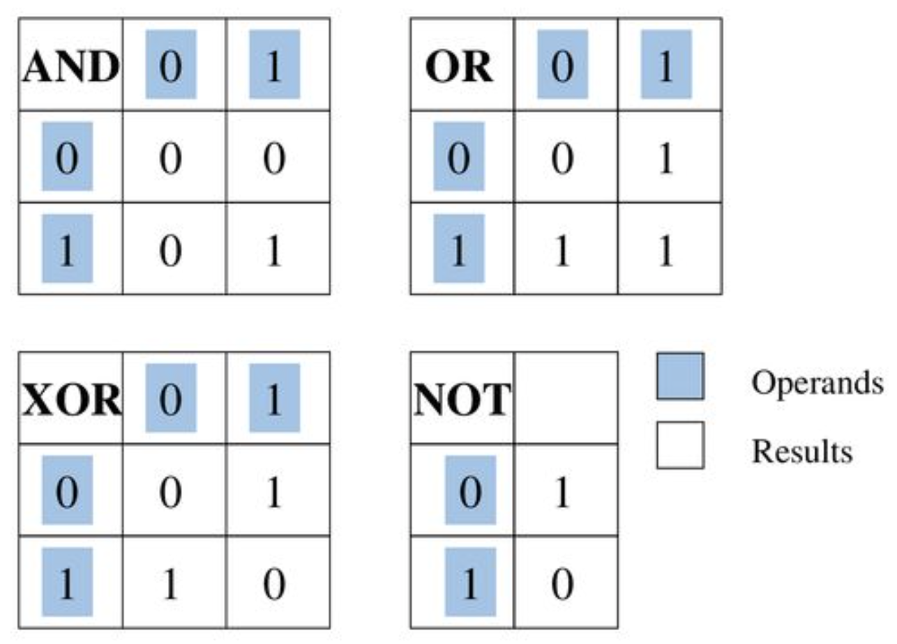

# Binary, Octal, Decimal and Hexadecimal


## Binary (base 2)

- `0b`  prefix
- e.g. `0b00111100`
- all information processed by a computer is in 0's and 1's!
- **bitwise operations** are performed on the binary representation of numbers

## Octal (base 8)

- `0`  prefix (sometimes has `0o`  prefix)
- e.g. `0777` 
- **file permissions** are typically in this format

## Decimal (base 10)

- e.g. `909`
- everyday use of numbers are typically in decimal format

## Hexadecimal (base 16)

- `0x`  prefix
- e.g. `0xABC8`
- used for **memory addresses** as they can store large numbers in a compact way


Q2. Show what the following decimal values look like in 8-bit binary, 3-digit octal, and 2-digit hexadecimal

**25**   ->  0b00011001 -> 0o031 -> 0x19

**127** -> 0b01111111 -> 0o177 -> 0x7f

How would you write a C program that does this?    **Demo in print_numbers.c** 


```shell
# Easy way to convert between bases in your terminal! (can be used in final exam)
$ python3
>>> bin(246)			# Convert decimal 29 into binary
'0b11101'
>>> oct(29)				# Convert into octal
'0o35'
>>> hex(29)				# Convert into hex
'0x1d'
>>> int(0x1d) 		# Convert back into decimal
29
>>> ctrl-D 				# to exit
```


# Bitwise Operations


### What is a mask

Basically creating some bit pattern to tell the processor which bits to work on and which to ignore. Usually 1 is set for the bits we want to process


Create a mask for each:

```c
// Extract the lower 4 bits of an 8 bit number
// 0b xxxx xxxx
uint8_t mask = 0b00001111; // mask = 0b1111; mask = 15; mask = 0x0000F
  
// Extract the bits from position 2-5 of an 8 bit number
uint8_t mask = 0b00111100; 
```


### & and

Think of this as an **extracting** operation - whichever bits are set in the mask, is extracted out of the original value

```c
//   0b xxxx xxxx  -- original value
// & 0b 0011 1100  -- mask
// = 0b 00xx xx00  -- final result

int a = 20 & 5; // What is the value of a?
//   0b 0001 0100
// & 0b 0000 0101
// = 0b 0000 0100

// Extract the rightmost bit 
// 0b xxxx xxxx
// 0b 0000 0001
// 0b 0000 000x
```


### | or

Think of this as a **setting** operation - whichever bits are set in the mask, are set in the final value

```c
//   0b xxxx xxxx  -- original value
// | 0b 0110 0110  -- mask
// = 0b x11x x11x -- final value

int a = 20 | 5; // What is the value of a?
//   0b 0001 0100
// | 0b 0000 0101
// = 0b 0001 0101 

// Set the right most bit
// 0b 1000 0000
// 0b 0000 0001
// 0b 1000 0001
```


### ^ XOR

XOR means if **ONLY ONE OR THE OTHER** bit is set, the final result is set. Exclusive OR. Not both, not neither.

```c
//   0b 1010 0000  -- original value
// ^ 0b 0010 1111  -- mask
// = 0b 1000 1111  -- final value
```


### ~ not

Flips every bit

```
   ~0b11110000 
  = 0b00001111
```


### << left shift (multiply by 2)

Shifts all the bits to the left, pads the right bits with 0

```c
uint8_t a = 0b 0000 0001 << 3 
        a = 0b 0000 1000 (8) // 1 * 2 * 2 * 2
  
int8_t b = 0b 1000 0000 << 1 // implementation defined
```


### >> right shift (divide by 2)

Shifts all the bits to the right

- unsigned variables do a logical shift
- signed variables do a arithmetic shift

```c
uint8_t b = 0b 0000 0111 >> 3	 // b = 0b 0000 0000
 int8_t a = 0b 1000 0000 >> 3 (-128) // a = 0b 1111 0000 (-16 = -128/2/2/2)
uint8_t c = 0b 1000 0000 >> 3 (128)  // c = 0b 0001 0000 (16)
```


### BCD - binary coded decimals (will be in labs!)

BCD is where each byte (8 bits, or 2 hex digits) is interpreted as 1 digit in decimal.

Note - all BCD's must be between 0 and 9 inclusive as that is the limit of a decimal. 0x0A0F would not be a valid

```shell
$ ./bcd 0x0A    # !! Not a valid BCD as A cannot be represented as a decimal digit from 0-9
$ ./bcd 0x 07    # equivalent to 
$ ./bcd 0x 01 02  # equivalent to 
$ ./bcd 0x 04 02  # equivalent to 
```


Packed BCD's are where the digits are packed closer together. So now each half byte (4 bits) is interpreted as 1 digit in decimal

```shell
$ ./packed_bcd 0x17   # equivalent to 
$ ./packed_bcd 0x4102   # equivalent to 
```


