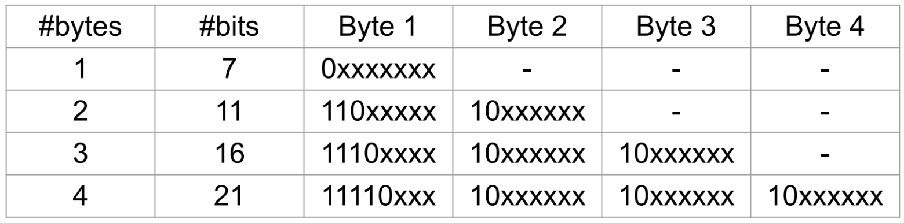

# UTF-8

7. Recall the UTF-8 encoding for characters below:

   Why did UTF-8 replace the ASCII coding standard? What is the difference in how ASCII and UTF-8 codepoints are represented in bytes?

   ```
   ASCII characters can only represent 128 unique characters (from 0 - 127). To be able to store more characters we need to find a new encoding.
   ASCII codepoints are 1 byte
   UTF-8 codepoints are variable width, between 1 to 4 codepoints
   ```

8. Write a C program that reads a null-terminated UTF-8 string as a command line argument and counts how many Unicode characters (code points) it contains. Assume that all codepoints in the string are valid. Some examples of how your program should work:

   ```
   $ gcc count_utf8.c -o count_utf8
   $ ./count_utf8 "チョコミント、よりもあなた！"
   there are 14 codepoints in the string
   $ ./count_utf8 "早上好中国现在我有冰淇淋"
   there are 12 codepoints in the string
   $ ./count_utf8 "🤓🤓🤓🤓🤓🤓🤓🤓"
   there are 8 codepoints in the string
   ```

   **_demo in `count_utf8.c`_**


# Environment variables

4. Write a C program, `print_diary.c`, which prints the contents of the file `$HOME/.diary` to stdout.

   `snprintf` is a convenient function for constructing the pathname of the diary file.


## Directory recursion

Write a C program, `recurse_sample.c`, that walks a directory tree and prints each matching file’s **permissions (ls -l style)** and **pathname** when the filename contains the substring `"hello"`.

1. **Part 1 — Print CWD**: Get and print the current working directory pathname.
   *Hint:* `getcwd()`
2. **Part 2 — List current directory**: Print one line per entry in the current directory (non-recursive):
   `<perms> <pathname>`
   *Hint: use* `readdir()` to recurse through subdirectories
3. **Part 3 — Recurse**: Recurse into all subdirectories and print pathnames in the same format as Part 1.
4. **Part 4 — Filter by name**: Only print lines for files whose *basename* contains `"hello"` (case-sensitive match).

**Output format** (one match per line):
`-rw-r--r-- ./examples/hello.txt`

**Example (setup & run):**

```
mkdir -p examples/sub
: > examples/hello.txt
: > examples/sub/nothe11o.c
: > examples/sub/hello_world.c
dcc -o recurse_sample recurse_sample.c

./recurse_sample .
-rw-r--r-- ./examples/sub/hello_world.c
-rw-r--r-- ./examples/hello.txt
```

*FILE* equivalent to *DIR* (both opaque data structures)

`FILE *f = fopen(...);`

`DIR *d = opendir(...);`


struct stat equivalent to struct dirent

`struct stat info; stat(pathname, &info);`

`struct dirent *info; info = readdir(d);`

